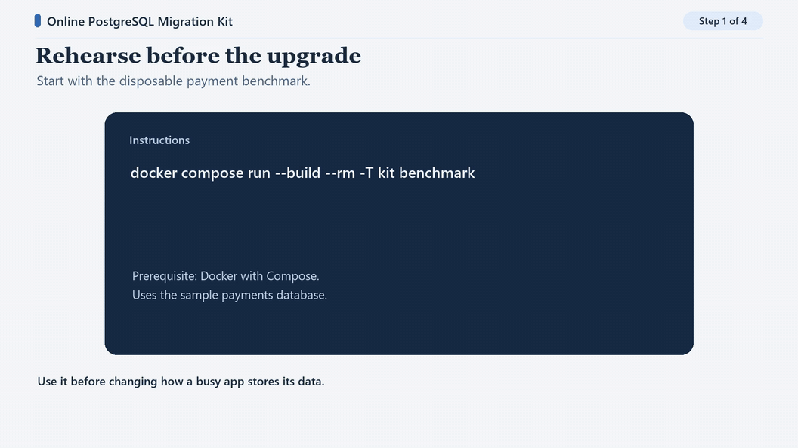
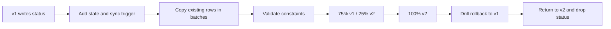

# Online PostgreSQL Migration Kit

Migrate a populated payments table while it serves writes. The demo starts on a legacy Go API, kills a real backfill process near the halfway checkpoint, resumes it, canaries a second API, and rolls back to the first. It then contracts the schema and verifies every seeded and acknowledged payment against its expected amount, currency, and state.

<!-- portfolio-demo-videos -->
## Watch the demo

Use it before changing how a busy app stores its data. The walkthrough has on-screen captions.



[Download the narrated walkthrough](docs/demo/how-to.mp4?raw=true) · [Download the narrated overview](docs/demo/overview.mp4?raw=true)

<!-- /portfolio-demo-videos -->

## Run the benchmark

With Docker and Compose v2:

```sh
docker compose run --build --rm -T kit benchmark
docker compose down
```

The benchmark prints a JSON report and exits with a nonzero status if any check fails. It creates and cleans up a uniquely named schema inside the selected database. The load generator and the two ephemeral HTTP servers run inside the benchmark process with independent database pools. The two backfill workers run as separate OS processes.

For a native run, use Go 1.26 or later and a PostgreSQL 18 database. The command defaults to the Compose database on loopback port 55496. Set `DATABASE_URL` to point to another scratch database whose user can create schemas.

```sh
docker compose up -d --wait db
go run . benchmark --output artifacts/benchmark.json
```

The larger reproducible run uses 100,000 seed payments, batches of 1,000 IDs, 12 clients, and a target of 400 write requests per second:

```sh
go run . benchmark --seed 100000 --batch-size 1000 --clients 12 --rate 400 --hold 1s --output artifacts/benchmark.json
```

The recorded Windows run used PostgreSQL 18.7. All **4,658 write requests succeeded**, and the final comparison found zero missing, duplicate, unexpected, or mismatched records across **102,333 rows**. The killed worker resumed at its last committed checkpoint of 51,000. During the canary, 301 requests went to v1 and 100 to v2. [Raw benchmark report](docs/benchmark.json)

The report includes observed request rates, failures, and p95 and p99 latency by phase. Timings reflect a local benchmark. The rollback interval measures the time from switching the route to successfully reading the v2-written witness through v1.

## Migration sequence



- **Expand.** The old API writes uppercase `status`. The new API writes normalized `state`. A PostgreSQL row trigger fills the matching value in the same transaction and rejects conflicting pairs. Expansion captures the highest existing ID under the DDL lock.
- **Backfill.** Each transaction locks the progress row, copies one bounded ID range, and advances the committed checkpoint. A lock timeout rolls back the batch and the worker retries it. New writes already populate both columns, so the worker stops at the original cutoff. Progress updates serialize competing workers.
- **Validate.** PostgreSQL validates the deferred checks while ordinary writes continue. The v2 API starts serving traffic only after the new column is populated and validated.
- **Cut over and roll back.** The benchmark routes individual requests at 25% and then 100% to v2. It creates and captures a witness payment through v2, rolls back to v1, and reads the exact v2-written payment through the legacy API.
- **Contract.** Once v1 traffic has drained and the rollback window has ended, promote the validated presence check to `NOT NULL` and remove the compatibility trigger and legacy column. Expansion and contraction request a brief exclusive DDL lock. The 500 ms lock timeout bounds each lock wait and lets the operator retry rather than queue indefinitely behind a busy transaction.

This keeps mixed application versions compatible through the rollback window. Once contracted, rolling back the application requires restoring compatibility first. The project models one concrete schema change on a synthetic dataset. Each production migration needs its own constraints, routing policy, and rehearsal. See [PostgreSQL ALTER TABLE](https://www.postgresql.org/docs/18/sql-altertable.html) and the [pgroll canary/schema-version discussion](https://github.com/xataio/pgroll/issues/997).

## Operate the steps manually

Set `MIGRATION_SCHEMA` to a dedicated test schema such as `payments_demo` in every terminal, along with `DATABASE_URL` if using a different database.

1. Run `go run . init --seed 10000` and start the legacy API in a separate terminal with `go run . serve --api v1 --listen 127.0.0.1:8897`.
2. Run `go run . expand` and `go run . backfill --batch-size 400 --pause 40ms`. Interrupt the worker and rerun the same command to resume. Use `go run . status` to inspect the committed checkpoint.
3. Run `go run . validate`, then start `go run . serve --api v2 --listen 127.0.0.1:8898` in its own terminal. Each app exposes `GET /readyz` for routing.
4. Send requests to both versions and roll traffic back to v1 to verify compatibility. When the rollback window closes, switch back to v2, stop v1, and run `go run . contract --confirm-v1-drained`.

Both versions accept the same HTTP contract:

| Request | Behavior |
| --- | --- |
| `POST /payments` | Body `{"id":"demo-1","amount_minor":4500,"currency":"USD"}`. Creates one pending payment. Repeating the same ID and attributes returns the existing payment. |
| `PUT /payments/demo-1/state` | Body `{"state":"captured"}` or `{"state":"refunded"}`. Advances payment state. A retry for the current state returns the existing payment. |
| `GET /payments/demo-1` | Reads the normalized payment record. |

The sample API binds to loopback by default and uses synthetic data.

## Verify

Run `go test ./...` and `go vet ./...`. Set `MIGRATION_TEST_DATABASE_URL` to enable integration tests against fresh disposable schemas, including a blocked-row timeout with no partial copy or checkpoint advance and concurrent idempotent writes across the two API versions. CI runs those tests with the race detector, runs the full benchmark in Docker, and uploads the report.
